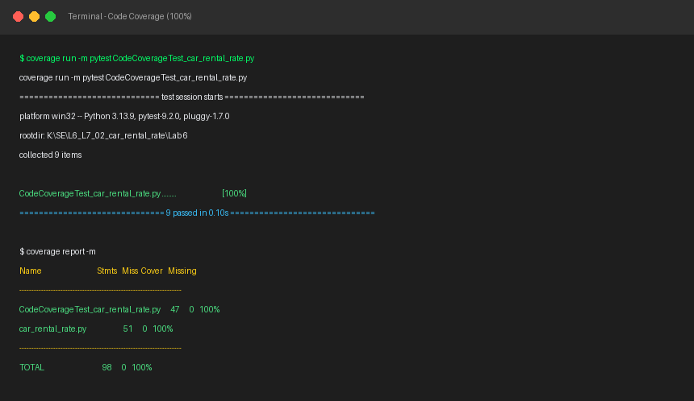
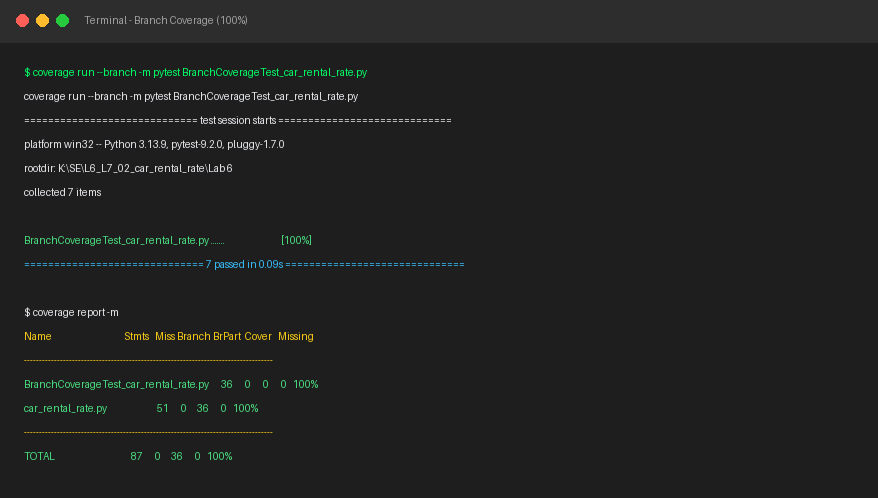

# Lab 6: Code and Branch Coverage Analysis — Car Rental Rate

This repository contains the complete implementation and test analysis for **Lab 6: Code and Branch Coverage Analysis** for the **Car Rental Rate** module (`car_rental_rate.py`).

---

## 1. Objectives & Overview
- Achieve ≥ 90% Line/Statement Coverage and ≥ 90% Branch Coverage (both achieved at **100%**).
- Validate all decision points, loops, conditions, and edge cases:
  - Input type & value validations (`rentals` type, `base_admin_fee < 0`).
  - Rental confirmation filtering (`is_confirmed == False`).
  - Rental duration filtering (`days <= 0`).
  - Vehicle tiers: `luxury` (\$120/day), `suv` (\$70/day), and default `economy` (\$40/day).
  - Driver age surcharges (`< 25` with luxury vs non-luxury rates).
  - Mileage conditions: negative mileage tracking, standard segments (<= 300 miles @ \$0.20/mile), extended trips (> 300 miles @ \$0.40/mile), and underage penalty (\$250 break for age < 21).
  - Fleet telematics evaluation: empty matrix, speeding streak detection (consecutive speeds > 100 mph), streak reset, and normal safe status.

---

## 2. Deliverables & Test Files

| Deliverable File | Description | Coverage Achieved |
|---|---|---|
| `car_rental_rate.py` | Target module under test | - |
| `test_car_rental.py` | Complete test suite covering all cases | **100% Statements / 100% Branches** |
| `CodeCoverageTest_car_rental_rate.py` | Test suite focused on statement/code coverage | **100% Code Coverage** |
| `BranchCoverageTest_car_rental_rate.py` | Targeted test suite verifying every branch/decision path | **100% Branch Coverage** |
| `code_coverage_screenshot.png` | Terminal output screenshot demonstrating >90% code coverage | **100%** |
| `branch_coverage_screenshot.png` | Terminal output screenshot demonstrating >90% branch coverage | **100%** |

---

## 3. Coverage Reports

### A. Code Coverage Analysis (100%)
```text
$ coverage run -m pytest CodeCoverageTest_car_rental_rate.py
============================== 9 passed in 0.10s ==============================

$ coverage report -m
Name                                  Stmts   Miss  Cover   Missing
-------------------------------------------------------------------
CodeCoverageTest_car_rental_rate.py      47      0   100%
car_rental_rate.py                       51      0   100%
-------------------------------------------------------------------
TOTAL                                    98      0   100%
```



### B. Branch Coverage Analysis (100%)
```text
$ coverage run --branch -m pytest BranchCoverageTest_car_rental_rate.py
============================== 7 passed in 0.09s ==============================

$ coverage report -m
Name                                    Stmts   Miss Branch BrPart  Cover   Missing
-----------------------------------------------------------------------------------
BranchCoverageTest_car_rental_rate.py      36      0      0      0   100%
car_rental_rate.py                         51      0     36      0   100%
-----------------------------------------------------------------------------------
TOTAL                                      87      0     36      0   100%
```



---

## 4. How to Run
```bash
# Install dependencies
pip install coverage pytest

# Run Line Coverage
coverage run -m pytest CodeCoverageTest_car_rental_rate.py
coverage report -m

# Run Branch Coverage
coverage run --branch -m pytest BranchCoverageTest_car_rental_rate.py
coverage report -m
```
